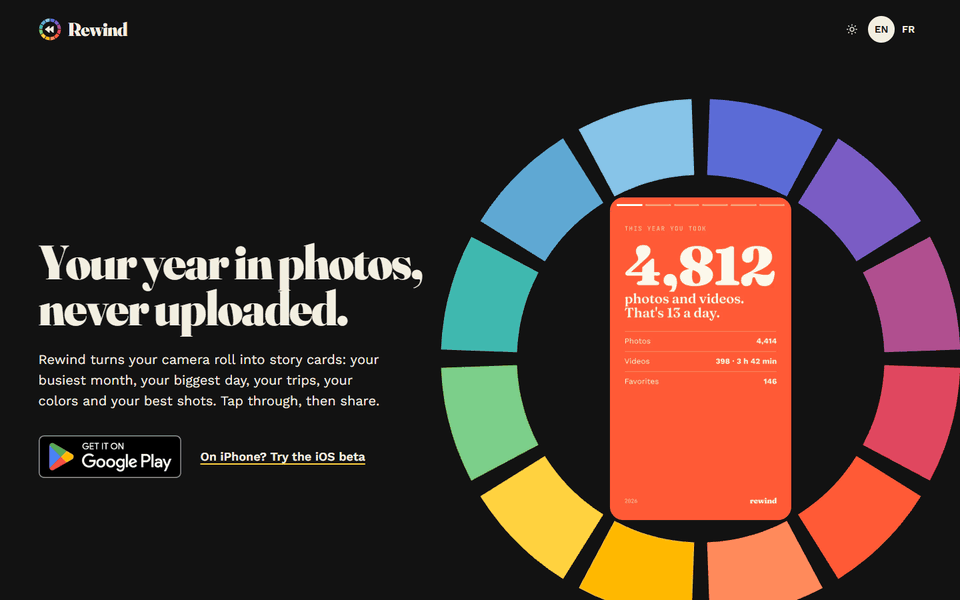
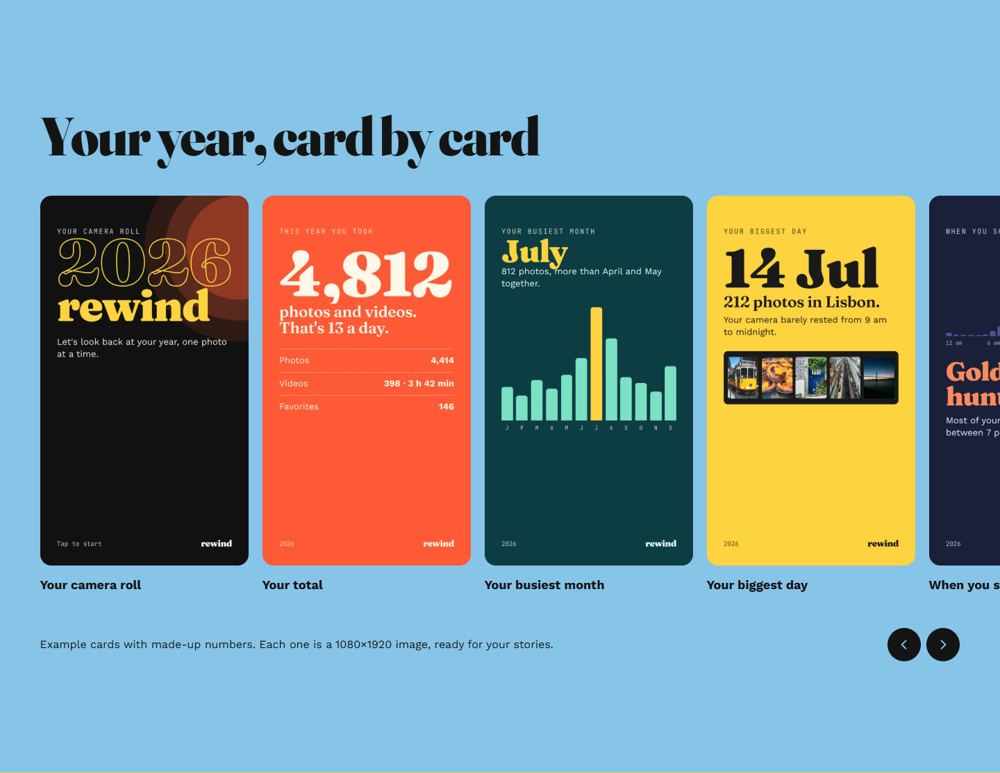
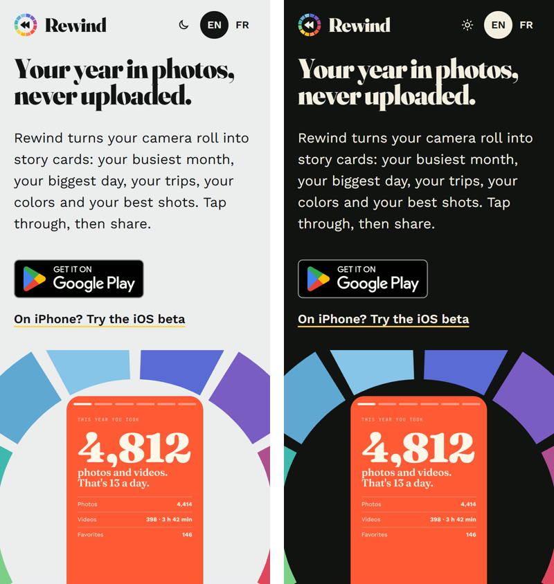

# Rewind

Your year in photos, as story cards you can tap through and share.

Rewind is a mobile app, out on Android, with the iPhone version in beta. It goes through your camera roll and turns it into cards:
your total, your busiest month, your biggest day, when you take photos, your trips, your photographer type,
your colors, your best nine, your first and latest photo, and a summary. Everything happens on the phone.
There's no server and no account, and your photos are never uploaded.

**Website: https://rewind.kozuma.studio**
· [Google Play](https://play.google.com/store/apps/details?id=studio.kozuma.rewind)

This repo is the website. The app itself is closed source.



## The site

One landing page and a privacy policy, in English and French, with a light and a dark theme.
Plain HTML, CSS and JavaScript, no framework and no build step.

The waitlist form goes through [FormSubmit](https://formsubmit.co), since the site has no backend.





## Files

- `index.html`, `privacy/index.html`: the two pages
- `css/`: `base.css` is shared, then one file per page
- `js/`: `prefs.js` applies the saved theme and language before the page shows, then one file per page
- `img/`: the example cards (`img/fr/` for French) and the social preview image
- `wrangler.jsonc`, `.github/workflows/deploy.yml`: deployed to Cloudflare by GitHub Actions

## Running it yourself

Serve the folder with any static server:

```
python -m http.server
```

then open http://localhost:8000.

The numbers on the cards are made up.
